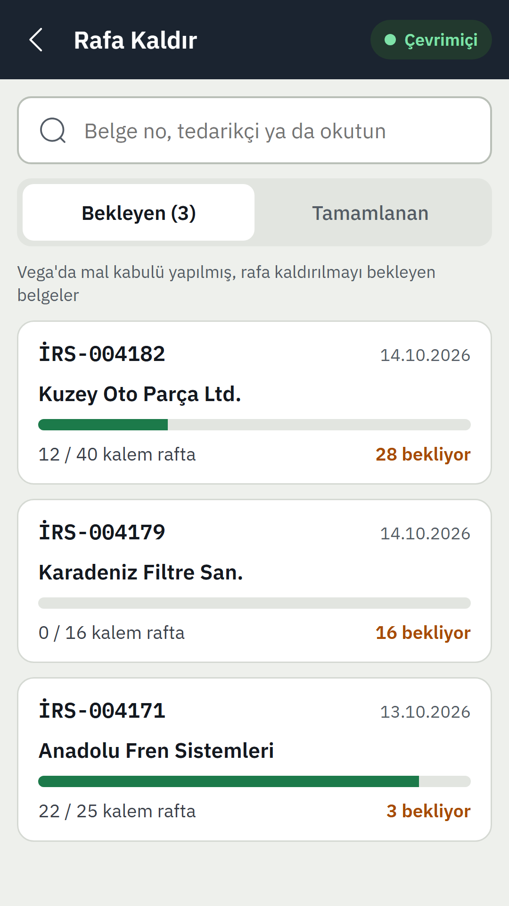
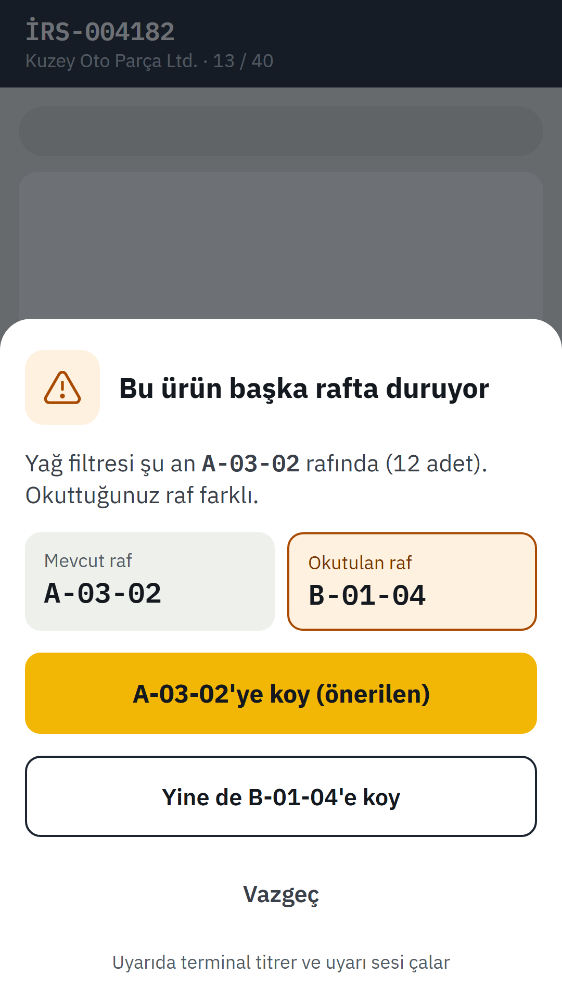
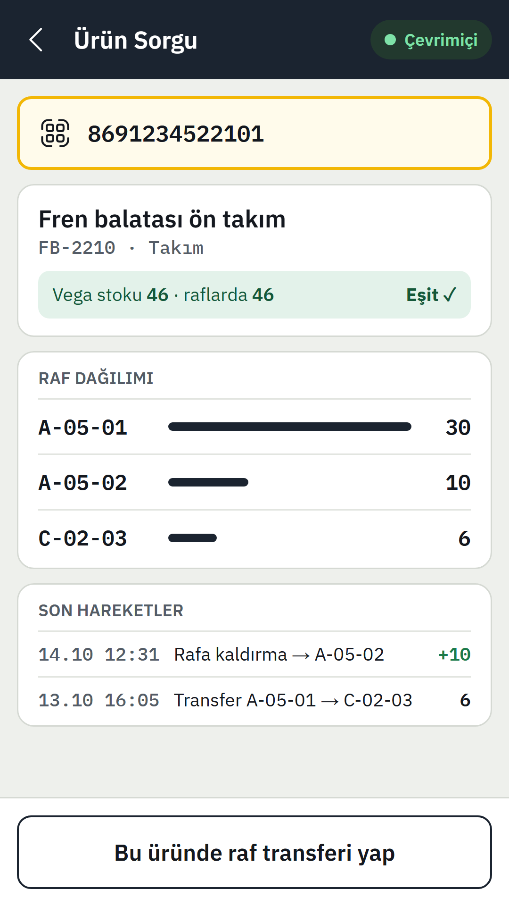
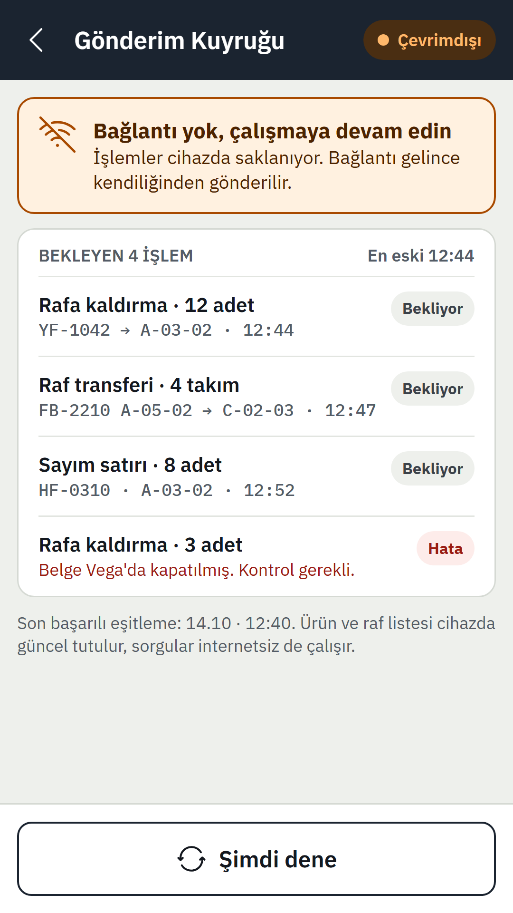
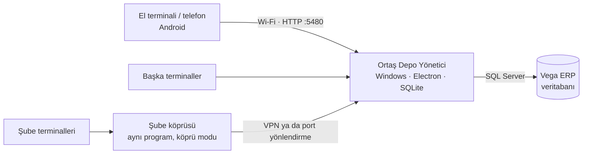

# Ortaş Depo Terminali

**Vega ERP'de kabul edilen malı el terminaliyle rafa kaldırın, sayın, taşıyın; hangi ürün hangi rafta, bir okutmada görün.**

[](https://github.com/saidbayraqtars/ortas-depo-terminali/releases/latest)


[](LICENSE)

Vega'da mal kabulü yapıldığı anda malın hangi rafa gideceğini, hangi rafta kaç adet durduğunu ve sayımda ne farkın çıktığını
takip etmek zordur: Vega depoyu bilir, rafı bilmez. Bu proje o boşluğu doldurur. Depodaki bir Windows bilgisayara kurulan **yönetici
programı** Vega'yı okur, el terminalleri ve telefonlar **Android uygulamasıyla** ona bağlanır. İnternet çekmeyen köşelerde de çalışır;
işlemler terminalde kuyruğa alınır, bağlantı gelince gönderilir.

Ortaş Otomotiv için yazıldı ve orada canlıda çalışıyor.

## Ekranlar

<table>
  <tr>
    <td align="center"><br><sub><b>Rafa kaldır</b><br>Vega'da kabul edilmiş belgeler</sub></td>
    <td align="center"><br><sub><b>Raf uyarısı</b><br>Ürün başka rafta duruyorsa</sub></td>
    <td align="center"><br><sub><b>Ürün sorgu</b><br>Vega stoku ve raf dağılımı</sub></td>
    <td align="center"><br><sub><b>Çevrimdışı</b><br>İşlemler kuyrukta bekler</sub></td>
  </tr>
</table>

Görüntüler arayüz taslağından ([`tasarim/`](tasarim/), 10 ekran); ürün, belge ve tedarikçi adları örnektir.

## Nasıl çalışır



1. Vega'da **mal kabulü** yapılır (alış faturası, irsaliye ya da stok giriş fişi).
2. Yönetici programı belgeyi Vega'dan okur ve terminallere **rafa kaldırılacak iş** olarak gönderir.
3. Depocu ürünü ve rafı okutur. **Raf stoku programın kendi veritabanında** tutulur (Vega raf bilmez); işlem terminalde de saklanır.
4. **Sayım** farkları yönetici programında görülür. Genel sayım onaylanırken istenirse Vega'ya sayım fişi olarak yazılır; raf sayımı Vega'ya dokunmaz.

Terminal önce çevrimdışı düşünülmüştür: ürün ve raf listesi cihazdadır, sorgular bağlantısız çalışır, işlemler tekrar gönderilse de bir kez işlenir.

## Özellikler

**Terminal (Android)**

- **Rafa kaldırma:** belgeyi seç, rafı okut, ürünleri peş peşe okut (her okutma 1 adet, adet girilmez). Belgesi olmayan stok da ürün okutarak kaldırılır. Ürün başka rafta duruyorsa titreşim ve ses ile uyarır.
- **Raftan al, raf transferi, ürün ve raf sorgu:** ürünün hangi rafta kaç adet durduğu, Vega stokuyla farkı, son hareketleri.
- **Raf Düzenle:** firma sıfırdan başlamıyorsa rafta duran mal, rafı ve ürünleri okutarak rafa tanımlanır. Onay beklemez, Vega'ya yazılmaz (yalnız raf stoku ve ürünün raf adresi). Okutulmayan ürünler varsayılan olarak rafta kalır.
- **Sayım:** raf, kat ya da bölge kapsamlı veya tam sayım; kör sayım seçeneği.
- **Depolar arası transfer:** Vega depo gönderim ve gönderim kabul fişleri terminalden yazılır; kısmi kabul, eksik kaydı.
- **İsimle arama:** barkodu okunmayan ürün, yazım hatası olsa da bulunur.
- **Etiket basma** (ürün ve raf), **belge kilidi** (aynı belgeyi iki kişi açmasın), **çevrimdışı kuyruk**.

**Yönetici programı (Windows)**

- Raf, kullanıcı ve cihaz yönetimi; **QR ile terminal kurulumu**.
- **Excel'den raf içe aktarma**: yüz binlerce kalemlik B2B listesi, çoklu raf adresi.
- **Raf ve ürün etiketi:** EAN-13 ya da Code 128, etiket yazıcısına sessiz yazdırma.
- **Çok depo**, şube bilgisayarı için **köprü modu**.
- **"Neden terminalde yok?" tanısı:** Vega'da görünen stokun terminale neden gelmediğini belge belge gösterir.
- Günlük otomatik yedek, GitHub Releases'tan **kendiliğinden güncelleme**.

## Kurulum

[Son sürümden](https://github.com/saidbayraqtars/ortas-depo-terminali/releases/latest) iki dosya indirilir:

| Dosya | Ne için |
|---|---|
| `OrtasDepoYonetici-Kurulum-<sürüm>.exe` | Depodaki Windows bilgisayara. Terminal APK'sı içinde gelir. |
| `OrtasDepo-<sürüm>.apk` | El terminali ve telefon (yalnız ARM). Terminaller APK'yı yönetici programının `/kur` adresinden de indirebilir. |

1. Yönetici programını kurun, **Ayarlar › Vega bağlantısı**ndan SQL sunucusunu, firmayı ve depoyu seçin.
2. **Cihazlar › Yeni cihaz** ekranındaki iki QR ile terminali kurup bağlayın.
3. Kullanıcı ekleyin, rafları açın (Excel'den ya da toplu), etiketleri yazdırıp rafa yapıştırın.

Ayrıntılı adımlar: [Kurulum ve kullanım](docs/KURULUM.md) · [El terminali ve okuyucu ayarları](docs/TERMINAL.md).
Sunucu bilgisayarına modemden sabit IP verilmesi önerilir.

## Vega ile çalışma

Program Vega veritabanını **okur**. Yazdığı yerler az ve bellidir; yazan her özelliğin ayarı vardır:

| Ne | Vega'da nereye | Varsayılan |
|---|---|---|
| Genel sayım farkı | Sayım giriş (93) ve çıkış (94) fişi, kendi belge numarası önekiyle | Onaylarken "Vega'ya sayım fişi yaz" seçilirse |
| Depolar arası transfer | Depo gönderim (128) ve gönderim kabul (129) fişleri | Kapalı |
| Raf adresi | Stok kartında seçtiğiniz özel kod alanı | Kapalı |

Yazma desenleri gerçek Vega kayıtlarından çıkarılıp kopya veritabanında denenmiştir. Yine de yazan özellikleri önce **kopya bir veritabanında**
deneyin ve kendi Vega sürümünüzde sütunların uyduğunu doğrulayın. Vega, sahibinin ticari markasıdır; bu proje Vega Yazılım'ın resmî bir ürünü değildir.

## Geliştirme

Yönetici programı için Node.js (`node:sqlite` nedeniyle 22.5+, 24 ile geliştirildi) gerekir:

```bash
cd yonetici
npm install
npm test              # sunucu testleri
npm run dev           # sunucu + arayüz (http://localhost:5173), veri ./veri
npm run desktop       # Electron ile aç
```

<details>
<summary>npm 11 kurulum betiklerini engeller</summary>

```bash
npm approve-scripts electron esbuild electron-winstaller
node node_modules/electron/install.js
```
</details>

Android uygulaması (Android Studio'nun JDK'sı yeterli, minSdk 25):

```bash
cd android
./gradlew assembleDebug      # emülatör ve deneme
./gradlew assembleRelease    # cihazlara kurulacak sürüm (kendi imza anahtarınız gerekir)
```

İmza anahtarı (`android/keystore*`), uzaktan hata raporu anahtarları ve müşteri verisi depoda yoktur. Rapor anahtarı yoksa hatalar yalnız yerelde kalır;
sürüm APK'sı için kendi imza anahtarınızı üretmeniz gerekir.
Ayrıntı: [`yonetici/README.md`](yonetici/README.md), [`android/README.md`](android/README.md).

## Depo yapısı

| Klasör | İçerik |
|---|---|
| [`android/`](android/) | Terminal ve telefon uygulaması (Kotlin, Jetpack Compose, SQLite, WorkManager, ML Kit) |
| [`yonetici/`](yonetici/) | Windows programı: sunucu + yönetim ekranı (Electron, Express, React, `node:sqlite`, `mssql`) |
| [`docs/`](docs/) | [Kurulum](docs/KURULUM.md) · [Terminal](docs/TERMINAL.md) · [Sunucu sözleşmesi (API)](docs/API.md) |
| [`tasarim/`](tasarim/) | Arayüz taslağı ve PNG çıktıları |
| [`araclar/`](araclar/) | Yardımcı araçlar: Vega veritabanı kopyalama, hata toplayıcı sunucusu |

## Lisans

[MIT](LICENSE), Said Bayraktar. Kullanabilir, değiştirebilir ve dağıtabilirsiniz; telif ve lisans satırının kalması yeter.
Yazılım olduğu gibi sunulur, Vega veritabanınıza yazan özellikleri kendi sorumluluğunuzda ve önce kopyada deneyin.

## Teşekkür

İkonlar [Reicon](https://github.com/dqev/reicon) (MIT), yazı tipi IBM Plex (OFL).

Geliştirme: [Said Bayraktar](https://github.com/saidbayraqtars) · ArcTeknik
